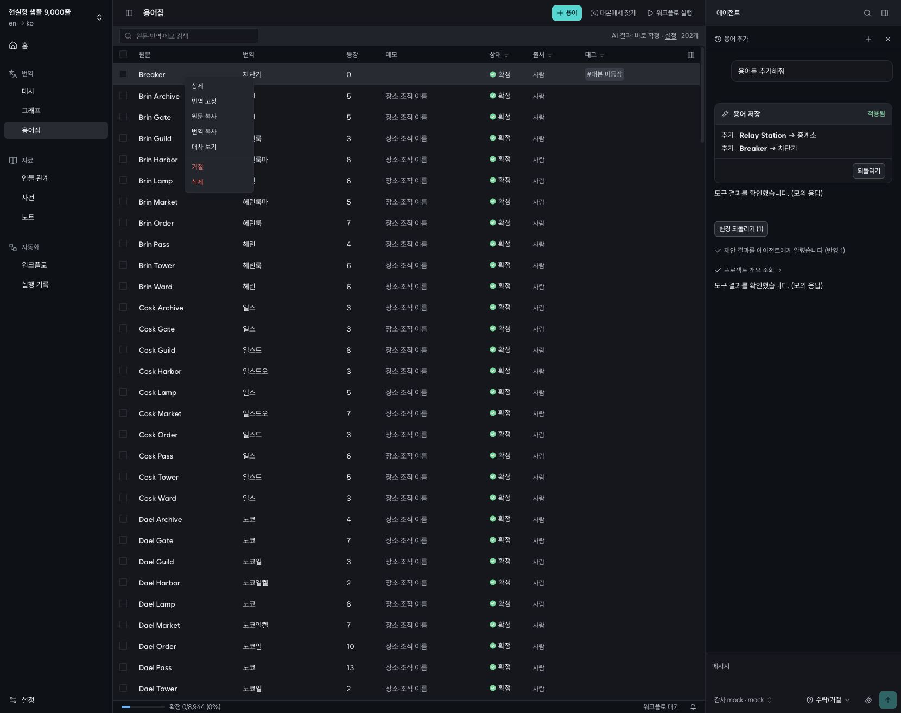
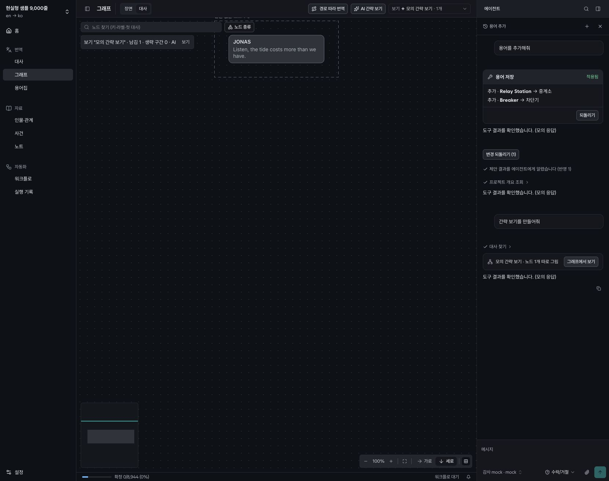

# 전체 프로젝트 리팩토링 조사 — 2026-10-27

> 2026-10-28: R01–R15 수정 및 검증 완료. [수정 결과](REFACTOR-FIXES-2026-10-28.md)를 참고하세요. 아래는 수정 전 감사 기록입니다.
조사 시작: 2026-10-27. 최종 검증·정리: 2026-10-28 (Asia/Seoul).

기준 커밋: `256068448747660e9150a94fd9fa5de3bce8250e`. 현재 개발 사양과 AGENTS.md를 기준으로 조사했다. **앱 구현은 수정하지 않았고, 조사 보고서와 재현 자료만 추가했다.**

우선순위가 높은 것은 큰 파일의 분할보다 **저장 충돌 방지, 자격 증명 복사의 일관성, 삭제/비동기 작업의 수명, 파생 데이터 갱신**이다. 아래 15개 중 R01–R12는 구체적 실패 또는 실패를 일으키는 경계를 확인한 항목이고, R13–R15는 정리 후보다. R13의 의존성 삭제는 추가 확인이 필요하다.

## 범위와 조사 수준

Git 추적 파일 **1,054개**를 목록화하고 파일 유형·크기·소스 참조·경계 위반 패턴을 조사했다. 구현 528, 테스트 161, 마이그레이션 94, 생성 파일 96, Storybook 93, 설정/문서 65, 에셋 17개다. 생성 파일·폰트·잠금 파일은 사람이 작성한 구현과 같은 방식으로 평가하지 않았다. `.idea/`는 기존 사용자 파일로 제외했다.

이것은 **전 파일 목록/구조 조사 + 위험 경로 심층 검토 + 실행 검증**이다. 모든 파일의 모든 분기와 줄을 수작업으로 검증했다는 뜻은 아니다. 파일별 기본 조사 수준은 [inventory.tsv](audits/2026-10-27/inventory.tsv)에, 심층 검토 묶음은 아래에 명시했다. 미발견을 무결함으로 해석하지 않는다.

| 영역 | 심층 검토 중심 | 판단 |
|---|---|---|
| apps/server | 라우트/서비스 경계, 저장·제안·취소, DB cascade, 연결 기본값/이전, SSE, graph view/layout, workflow runner | R02–R08·R11·R15 우선. 기존 서비스 계층과 엔진은 유지 |
| apps/web | 초안/저장/optimistic, URL 상태, 그래프/워크플로, 전역 채팅, 용어·자료·설정 | R01·R06·R09·R10·R14. 일반화보다 상태 불변조건 정리 |
| apps/cli + skills | 프로젝트/워크플로 해석, export/import, 공용 script service, 제안 경로, 명령 문서 | 직접 DB 쓰기 새 경로는 발견하지 않음. CLI 1,086줄만으로 분리하지 않음 |
| packages/ai | HTTP/CLI/ACP 어댑터, 오류/사용량, timeout/cancel, 임시 파일, MCP host | 기존 SDK/프로세스 어댑터 유지. R11·R12·R13 |
| packages/shared | Zod 경계, workflow/reading-route/graph-contract, import 및 model choice | 공용 스키마 유지. 그래프 원본과 파생 연결 구분 유지 |
| packages/ui | DataTable 가상화, dock/inspector, 패널 크기, 토큰·팔레트, Storybook 구성 | 공용 UI 유지. R13·R14. 규칙 검사 통과 |
| DB·도구·문서 | 스키마/마이그레이션 참조, 생성물, samples/mock/budget, 기존 리팩토링 문서 | 과거 감사에서 이미 해결된 순환 import·후보 저장 통합을 다시 과제로 세지 않음 |

판단 기준은 사용자 데이터/자격 증명 영향, 재현 빈도와 도달 경로, 영향 범위, 증거 강도, 개선 비용과 회귀 위험이다. P1은 데이터/자격 증명 보호 우선, P2는 기능 정확성·회복성·규모 문제, P3는 유지보수 정리다. S는 한 경계의 작은 변경, M은 여러 저장/상태 경계를 함께 다루는 변경이며 일정 견적은 아니다.

## 우선순위 목록

| ID | 우선순위 | 대상 | 근거 | 규모 |
|---|---|---|---|---|
| R01 | P1 | 번역 초안이 다른 저장을 충돌 없이 덮어씀 | 브라우저 재현 | M |
| R02 | P1 | 연결 기본값 복사가 이전 API 키를 새 주소에 남김 | 서비스 재현 | S–M |
| R03 | P1 | 연결 마이그레이션이 키 복사 실패 전에 완료 처리됨 | 서비스 재현 | M |
| R04 | P2 | 삭제 취소가 자료의 태그를 복원하지 않음 | 서비스 재현 | M |
| R05 | P2 | 계산 도중 수정한 그래프 보기에 오래된 레이아웃이 저장됨 | 서비스 재현 | M |
| R06 | P2 | 실패한 저장의 롤백이 다른 성공한 변경까지 되돌림 | QueryClient 재현 | M |
| R07 | P2 | 원문 수정 후 용어 등장 횟수와 예문 캐시가 낡음 | 서비스 재현 | M |
| R08 | P2 | 그래프 keep 해석이 참조마다 전체 대사를 다시 읽음 | 9천 줄 측정 | S |
| R09 | P2 | 용어집 번역 고정이 성공 알림만 표시함 | 브라우저·소스 확인 | S(제거) / M(구현) |
| R10 | P2 | 연결 설정의 일반 필드 초안이 화면 이동으로 소실됨 | 브라우저 재현 | S–M |
| R11 | P2 | 대화 삭제와 실행 중 턴·MCP 자원의 수명이 분리됨 | 삭제 경로 재현 + 소스 확인 | M |
| R12 | P2 | CLI 테스트가 다른 실행의 임시 폴더까지 누수로 판정함 | 전체 테스트 실패·단독 통과 | S |
| R13 | P3 | 직접 사용이 확인되지 않는 의존성 선언 16개 | 전 추적 파일의 참조 스캔 | S |
| R14 | P3 | 태그 생성·부착 코드와 오래된 색상 접근이 8곳에 복제됨 | 소스 참조 확인 | S–M |
| R15 | P3 | 형식 규칙 추정 라우트가 잘못된 접두사로 중복 등록됨 | 소스·호출 참조 확인 | S |

## 상세 근거와 가장 작은 개선 방향

### R01 · P1 · 번역 초안이 다른 저장을 충돌 없이 덮어씀

위치: [translation-editor.tsx](https://github.com/bh2980/translation_workbench/blob/256068448747660e9150a94fd9fa5de3bce8250e/apps/web/src/components/translation-editor.tsx#L159). 증거: 브라우저 재현.

번역을 입력한 뒤 다른 요청으로 같은 줄을 저장하고 SSE를 받은 상태에서 ⌘S를 누르면, 다른 저장이 경고 없이 덮어써진다. 격리 샘플 s1.l1에서 서버 값을 “다른 창에서 먼저 저장한 번역”으로 바꾼 후 기존 초안 “감사 중인 내 초안”을 저장해 확인했다.

**원인:** 초안은 텍스트만 보관하고 저장 시 비교 기준 base는 최신 unit.translation에서 가져온다. 서버의 충돌 검사는 있어도 편집 시작 시점의 값이 아니어서 보호하지 못한다.

**개선:** 기존 초안 저장소를 {text, base 또는 revision}로 확장한다. SSE는 기준값을 바꾸지 않고, 저장 성공·명시적 재불러오기 때만 기준을 갱신한다. 범용 상태관리 계층을 새로 만들 필요는 없다.

**완료 조건:** SSE 도착 전후와 새로고침 후에도 같은 초안 기준을 유지하고, 오래된 저장이 409/충돌 화면으로 이어지는지 확인.

### R02 · P1 · 연결 기본값 복사가 이전 API 키를 새 주소에 남김

위치: [app-defaults.ts](https://github.com/bh2980/translation_workbench/blob/256068448747660e9150a94fd9fa5de3bce8250e/apps/server/src/services/app-defaults.ts#L62). 증거: 서비스 재현.

같은 이름의 프로젝트 연결에는 키가 있고 홈 연결에는 키가 없을 때, 홈 기본값을 복사하면 주소는 홈의 값으로 바뀌지만 프로젝트의 기존 키는 남는다. .invalid 주소와 가짜 키로 재현했다. 새 대상에 이전 키가 사용될 수 있다. 실제 키 전송은 수행하지 않았다.

**원인:** copyConnections는 연결 필드를 덮어쓰지만 copyKeys는 원본 키가 null인 경우 아무 작업도 하지 않는다. 필드와 자격 증명의 복사 의미가 다르다.

**개선:** 연결 복사의 자격 증명 정책을 명시적으로 하나로 정의한다. 전체 복사라면 원본에 키가 없을 때 대상 키도 제거한다. 주소 변경과 키 적용 실패가 반쪽 상태를 만들지 않게 복구 정보를 유지한다.

**완료 조건:** 기존 대상 키 유무 × 원본 키 유무 × 주소 변경 조합과 키 저장소 실패를 확인.

### R03 · P1 · 연결 마이그레이션이 키 복사 실패 전에 완료 처리됨

위치: [connection-split.ts](https://github.com/bh2980/translation_workbench/blob/256068448747660e9150a94fd9fa5de3bce8250e/apps/server/src/services/connection-split.ts#L40). 증거: 서비스 재현.

키 저장소의 set 실패를 주입하면 DB는 이전을 완료한 것으로 기록하지만 프로젝트 키는 복사되지 않는다. 다시 splitConnections를 호출해도 0을 반환하고 누락된 키를 복구하지 않는다.

**원인:** DB 트랜잭션 안에서 완료 표시를 먼저 기록하고 트랜잭션 뒤에 외부 키 저장소를 갱신한다.

**개선:** 복사할 ID 쌍과 진행 상태를 남겨 재시작 시 안전하게 재시도하도록 만든다. 키 복사 완료 후 최종 완료 처리한다. DB 트랜잭션만으로 OS 키 저장소까지 원자적으로 처리할 수 있다고 가정하지 않는다.

**완료 조건:** 첫 키·중간 키 실패와 재시작을 주입하고 중복 연결 없이 모든 참조와 키가 복구되는지 확인.

### R04 · P2 · 삭제 취소가 자료의 태그를 복원하지 않음

위치: [item-delete.ts](https://github.com/bh2980/translation_workbench/blob/256068448747660e9150a94fd9fa5de3bce8250e/apps/server/src/services/item-delete.ts#L72). 증거: 서비스 재현.

태그가 붙은 인물을 삭제한 뒤 취소하면 인물은 복구되지만 태그 연결은 1개에서 0개가 된다. restoreItems는 성공을 반환한다.

**원인:** 삭제 스냅샷에 knowledgeTags가 없고 DB의 삭제 트리거는 해당 연결을 제거한다. 본문 행과 일부 관계만 저장하는 복원 모델이 실제 cascade 범위와 다르다.

**개선:** 삭제 스냅샷을 실제 삭제되는 종속 행까지 포함하는 명시적 형태로 만든다. 복원 트랜잭션 성공 뒤 토큰을 소비하도록 함께 정리한다.

**완료 조건:** 인물·관계·사건과 태그/메모를 삭제 전후 비교한다. 이번 실행 증거는 인물의 knowledgeTags 손실이다.

### R05 · P2 · 계산 도중 수정한 그래프 보기에 오래된 레이아웃이 저장됨

위치: [layout.ts](https://github.com/bh2980/translation_workbench/blob/256068448747660e9150a94fd9fa5de3bce8250e/apps/server/src/services/layout.ts#L151). 증거: 서비스 재현.

노드 2개의 보기 계산을 시작하고 완료 전에 1개를 제거했다. DB 보기에는 1개, ready 레이아웃에는 2개와 이전 제목이 남았으며 다시 열어도 재계산되지 않았다.

**원인:** 진행 중 작업은 project/key/direction만으로 재사용되고 완료 시 보기의 현재 구성이나 삭제 여부를 확인하지 않는다. updateView가 캐시를 지운 뒤 이전 작업이 다시 채울 수 있다.

**개선:** 보기 구성 revision/hash를 작업과 캐시에 포함한다. 완료 시 현재 revision과 비교해 오래된 결과를 버리고 최신 작업을 실행한다. 삭제 시에도 해당 작업을 종료하거나 결과 저장을 막는다.

**완료 조건:** 계산 중 추가·제거·제목 변경·보기 삭제와 연속 열기. 오래된 ready 결과가 남지 않아야 한다.

### R06 · P2 · 실패한 저장의 롤백이 다른 성공한 변경까지 되돌림

위치: [optimistic.ts](https://github.com/bh2980/translation_workbench/blob/256068448747660e9150a94fd9fa5de3bce8250e/apps/web/src/lib/optimistic.ts#L11). 증거: QueryClient 재현.

A 저장의 낙관적 변경 이후 B 저장과 서버 응답이 반영된 목록에서 A의 undo를 호출하면 B도 예전 값으로 돌아간다. 재현 결과 server-confirmed-b가 old-b가 됐다. DB 손실이 아니라 화면 캐시의 잘못된 복원이다.

**원인:** 실패 요청이 건드린 행/필드만 복원하지 않고 목록 쿼리 전체의 이전 스냅샷을 복원한다. 실패 요청에는 추가 서버 변경 이벤트가 없을 수 있다.

**개선:** 항목·필드별 변경과 요청 순서를 고려한 롤백으로 좁히거나, 충돌 시 해당 쿼리를 무효화해 서버 값으로 복원한다. 성공한 후속 응답을 이전 스냅샷으로 덮지 않도록 한다.

**완료 조건:** A 실패/B 성공, SSE가 둘 사이에 도착, 같은 행 연속 저장을 순서별로 확인.

### R07 · P2 · 원문 수정 후 용어 등장 횟수와 예문 캐시가 낡음

위치: [term-usage.ts](https://github.com/bh2980/translation_workbench/blob/256068448747660e9150a94fd9fa5de3bce8250e/apps/server/src/services/term-usage.ts#L17). 증거: 서비스 재현.

tower가 한 번 나오는 원문을 다른 내용으로 수정했다. 실제 등장 목록은 0줄인데 fillTermUsage 이후에도 terms.lines는 1이다. 새로고침만으로 DB 캐시가 고쳐지지 않는다.

**원인:** lines가 null인 용어만 재계산하며 source-mutations의 원문 수정은 해당 캐시를 무효화하지 않는다. terms 주제의 등장 목록 쿼리는 units를 읽지만 units 변경에서 terms로 이어지는 IMPLIES도 빠져 있다.

**개선:** 원문·화자·가져오기·삭제 등 원본 변경의 공통 경계에서 등장 수/예문을 무효화한다. SSE 의존성은 events.ts의 IMPLIES로 표현한다. 렌더링마다 전체 재계산하거나 폴링을 추가하지 않는다.

**완료 조건:** 원문과 화자의 추가·수정·삭제 이후 목록의 수와 실제 등장 목록이 일치하는지 확인.

### R08 · P2 · 그래프 keep 해석이 참조마다 전체 대사를 다시 읽음

위치: [graph-views.ts](https://github.com/bh2980/translation_workbench/blob/256068448747660e9150a94fd9fa5de3bce8250e/apps/server/src/services/graph-views.ts#L73). 증거: 9천 줄 측정.

동일한 9천 줄 샘플에서 keep 1/100/500/2000개를 지정했다. SQL 준비 횟수는 4/103/503/2003회, 경과 시간은 11/216/1075/4295ms였다. 2000개는 도구가 허용하는 입력 범위다.

**원인:** keep 루프에서 resolve([ref])를 호출할 때마다 프로젝트의 모든 unit을 조회하고 노드를 다시 순회한다. 동기 SQLite/JS 처리가 서버 요청 스레드를 차지한다.

**개선:** pickNodes 호출당 unit key/id 및 node key/id 인덱스를 한 번 만들고 일괄 해석한다. Worker나 새 캐시 서비스보다 이 반복 전체 조회 제거가 우선이다.

**완료 조건:** 같은 샘플에서 결과·unknown·reason 일치와 조회 횟수가 keep 개수에 비례하지 않음을 확인. 시간은 이 기기의 단회 측정이며 일반적인 성능 보장은 아니다.

### R09 · P2 · 용어집 번역 고정이 성공 알림만 표시함

위치: [p.$projectId.glossary.tsx](https://github.com/bh2980/translation_workbench/blob/256068448747660e9150a94fd9fa5de3bce8250e/apps/web/src/routes/p.$projectId.glossary.tsx#L272). 증거: 브라우저·소스 확인.

Breaker의 “번역 고정”을 누르면 성공 알림이 나오지만 새로고침 후 다시 “번역 고정” 메뉴가 나온다. 여러 항목을 고르면 여러 개를 고정했다고 알리지만 코드가 바꾸는 것은 선택한 row 하나다.

**원인:** 타입에 없는 locked 속성을 any로 추가하고 toast만 표시한다. 서버 요청·스키마·AI 쓰기 경로의 고정 검사가 없다.

**개선:** 현재 사양에 없는 기능이라면 메뉴와 임시 속성을 제거하는 것이 가장 작다. 기능을 유지할 때만 서버 계약과 AI 쓰기 보호까지 완성한다. 문구만 고치거나 로컬 저장으로 감추지 않는다.

**완료 조건:** 메뉴 유지 시 저장·재접속·다중 선택·AI 변경 보호를 함께 검증. 제거 시 다른 메뉴 동작 확인.

### R10 · P2 · 연결 설정의 일반 필드 초안이 화면 이동으로 소실됨

위치: [connections.tsx](https://github.com/bh2980/translation_workbench/blob/256068448747660e9150a94fd9fa5de3bce8250e/apps/web/src/components/settings/connections.tsx#L282). 증거: 브라우저 재현.

연결 이름을 “보존되어야 할 연결 초안”으로 편집하고 용어집으로 이동한 뒤 브라우저 Back을 누르면 이름은 “감사 mock”으로 돌아가고 저장 버튼이 비활성화된다.

**원인:** 이 화면은 프로젝트의 기존 초안 보존 도구와 달리 컴포넌트 수명의 React Hook Form 상태만 쓴다.

**개선:** 이름·주소·실행 파일 같은 일반 필드에 기존 sessionStorage 초안 패턴을 적용한다. API 키를 일반 초안처럼 sessionStorage에 저장하라는 의미는 아니다. 키는 별도 수명 정책을 유지한다.

**완료 조건:** Back/Forward·패널 닫기·새로고침·다른 연결 전환에서 초안 분리 및 보존을 확인. 저장 중 추가 입력도 별도 확인한다.

### R11 · P2 · 대화 삭제와 실행 중 턴·MCP 자원의 수명이 분리됨

위치: [chat.ts](https://github.com/bh2980/translation_workbench/blob/256068448747660e9150a94fd9fa5de3bce8250e/apps/server/src/routes/chat.ts#L256). 증거: 삭제 경로 재현 + 소스 확인.

실행 중 턴을 만든 뒤 실제 DELETE 라우트를 호출하면 HTTP 200이고 대화 행은 0개지만 signal.aborted=false이며 턴은 계속 등록돼 있다. CLI 채팅은 별도로 hostTools의 dispose를 버리고 서버 Map에 항목을 계속 남긴다.

**원인:** 삭제 경로는 DB 행만 지운다. 프런트 dropChat의 스트림 중단은 서버 소유 턴 종료와 다르다. MCP 토큰/클로저 해제 책임도 연결되지 않았다.

**개선:** 대화 종료 서비스를 두어 턴 중단·종료 대기·CLI 세션 닫기·MCP dispose·맵 정리·DB 삭제 순서를 명시한다. 프로젝트 삭제에도 같은 정리 경계를 사용한다.

**완료 조건:** 실행 중/종료된 대화 삭제, 재연결, CLI 세션 반복 생성·삭제를 검사. 이번 재현은 취소 신호 미전달이며 실제 외부 과금이나 삭제 후 쓰기까지 측정한 것은 아니다.

### R12 · P2 · CLI 테스트가 다른 실행의 임시 폴더까지 누수로 판정함

위치: [cli-fake.test.ts](https://github.com/bh2980/translation_workbench/blob/256068448747660e9150a94fd9fa5de3bce8250e/packages/ai/src/cli-fake.test.ts#L37). 증거: 전체 테스트 실패·단독 통과.

전체 테스트는 1093개 중 1개가 실패했다. 실패는 version/model 목록 테스트의 afterEach에서 tw-call-UnJkyQ를 발견한 것이며, 같은 파일 단독 실행은 38개 모두 통과했다.

**원인:** 테스트 전후 OS 공용 tmpdir의 모든 tw-call-*를 비교해 이 테스트가 만들지 않은 폴더까지 포함한다. 현재 증거로 제품의 임시 파일 누수라고 단정할 수 없다.

**개선:** 테스트별 임시 루트나 생성 경로 추적을 주입해 자신의 리소스만 확인한다. 병렬 실행을 끄거나 정리 검사를 삭제하는 방식은 피한다.

**완료 조건:** 다른 CLI 호출과 동시에 실행해도 자신의 생성물만 검사하고, 의도적으로 남긴 폴더는 확실히 탐지해야 한다.

### R13 · P3 · 직접 사용이 확인되지 않는 의존성 선언 16개

위치: [package.json](https://github.com/bh2980/translation_workbench/blob/256068448747660e9150a94fd9fa5de3bce8250e/apps/web/package.json#L1). 증거: 전 추적 파일의 참조 스캔.

web 10개, UI 3개, server·AI·shared 각 1개의 직접 의존성에 소유 패키지 내 문자열 import/require 참조가 없다. 전체 목록과 다른 패키지의 실제 사용 위치는 inventory-summary.json에 저장했다.

**원인:** 공유 UI로 이동한 의존성이 앱 manifest에도 남아 있고 일부는 저장소 전체에 런타임 참조가 없다. 동적 로딩·peer 제공 가능성 때문에 스캔만으로 삭제 확정을 하지 않았다.

**개선:** 소유 패키지의 실제 책임과 peer/config 사용을 확인해 직접 선언을 제거하고 잠금 파일을 갱신한다. UI가 여전히 쓰는 라이브러리는 전이 의존성으로 남으므로 번들 절감량을 과장하지 않는다.

**완료 조건:** 깨끗한 설치 후 typecheck·앱/Storybook build·관련 테스트. 설치 크기나 번들 변화는 실제 비교 때 기록.

### R14 · P3 · 태그 생성·부착 코드와 오래된 색상 접근이 8곳에 복제됨

위치: [term-pane.tsx](https://github.com/bh2980/translation_workbench/blob/256068448747660e9150a94fd9fa5de3bce8250e/apps/web/src/components/glossary/term-pane.tsx#L117). 증거: 소스 참조 확인.

대사 상세·행·그래프 카드·경로 목록·용어·인물/관계 등 8곳에 PALETTE 항목의 any.light ?? .hex 접근과 생성 후 부착 흐름이 반복된다.

**원인:** 같은 업무 규칙이 화면별 mutation·오류 처리·캐시 갱신과 함께 복제되어 스코프나 색상 정책 변경 시 수정 지점이 늘어난다.

**개선:** 색상 선택과 태그 생성/부착만 작은 공통 함수 또는 훅으로 모은다. 화면 전체를 범용 CRUD 컴포넌트로 통합할 필요는 없다. 타입으로 실제 팔레트 구조를 사용한다.

**완료 조건:** 대사와 자료 양쪽에서 새 태그 생성→부착→SSE 갱신, 생성 성공 후 부착 실패 처리 확인.

### R15 · P3 · 형식 규칙 추정 라우트가 잘못된 접두사로 중복 등록됨

위치: [projects.ts](https://github.com/bh2980/translation_workbench/blob/256068448747660e9150a94fd9fa5de3bce8250e/apps/server/src/routes/projects.ts#L92). 증거: 소스·호출 참조 확인.

같은 핸들러가 /:projectId/detect-format-rules와 /projects/:projectId/detect-format-rules 두 번 등록된다. 라우터 자체가 /api/projects 아래여서 후자는 /api/projects/projects/...가 된다. 프런트는 정상 경로를 호출한다.

**원인:** 복제 핸들러가 남아 있고 프런트의 해당 호출은 any로 타입 검사를 우회한다.

**개선:** 잘못된 중복 경로를 제거하고 정상 경로의 Hono 클라이언트 타입을 연결한다. 현재 사양상 호환용 별칭을 유지할 근거가 없다.

**완료 조건:** 정상 경로 응답과 클라이언트 타입 검사. 잘못된 경로에 의존하는 외부 사용은 이번 로컬 저장소 조사 범위 밖이다.

## 큰 파일을 다루는 방법

다음은 즉시 결함으로 분류하지 않은 구조 후보다. 파일 길이를 줄이는 것을 완료 조건으로 삼지 않는다.

| 후보 | 분리할 수 있는 책임 | 착수 조건 |
|---|---|---|
| graph route (1,428줄) | URL 선택/모드 전이, 현재 표시 그래프 모델, 편집/보기 동작 | R05를 고치며 revision과 선택 상태가 명확해진 뒤, Back/Forward 회귀 검증을 유지할 수 있을 때 |
| workflow editor route (1,074줄) | 초안 저장 상태, 그래프 편집 명령, 노드 속성 패널 조립 | 기존 workflow-draft를 재사용. 새 전역 store를 만들지 않음 |
| runner (1,019줄) | 실행 스케줄링과 AI 호출 결과 적용/실패 전이 | budget 및 실패/재개 테스트가 보호하는 경계를 먼저 명시. 일괄 파일 쪼개기는 보류 |
| CLI main (1,086줄) / agent-tools (972줄) | 업무별 명령 등록과 출력 포맷 / 도구군 | 같은 서비스를 호출하는 원칙을 보존하며 관련 기능을 수정할 때 점진적으로 이동 |

유지할 구조: server의 routes→services/engine 방향과 순환 import 방지 테스트, 공통 line-save/change-gate/script-query, AI SDK·execa·ELK·React Flow·Canvas의 역할 분담, SSE 기반 갱신, 공용 @loca/ui. 이미 있는 장치를 새 추상화로 대체하는 것은 이번 결과가 요구하지 않는다.

AGENTS의 “CLI/채팅 변경은 제안”과 최신 사양의 show_graph 보기 직접 저장은 정책 문구가 서로 다르다. 최신 사양 6.4–6.5와 현재 동작에 맞춰 **보기 생성의 예외를 문서에 명시할 후보**이며, 현재 구현을 무단 데이터 변경 버그로 판정하지 않았다. 워크플로의 가로/세로 선택도 최신 화면 동작을 확인했으므로 방향만으로 결함을 세지 않았다.

## 실행 검증

모든 제품 쓰기는 `/tmp/tw-refactor-audit-20261027`의 격리 DB와 메모리 키 저장소에서 했다. 실제 AI 서비스·사용자 번역·실제 키는 사용하지 않았다. API 4517, Vite 4518, mock LLM 4598, `MOCK_PROFILE=cli-like,faulty`를 사용했다.

| 검사 | 결과 |
|---|---|
| pnpm typecheck | 6개 패키지 통과 |
| pnpm build | 통과. 큰 chunk 경고는 있었으나 크기만으로 성능 결함을 만들지 않음 |
| pnpm ui-rules | 통과 |
| pnpm test | 161 파일 중 160 통과/1 실패, 1093 테스트 중 1092 통과/1 실패 (R12) |
| cli-fake.test.ts 단독 재검사 | 38/38 통과. 전체 테스트 통과로 대신 보고하지 않음 |
| pnpm budget | 7 시나리오 완료, 미종료 실행 0. faulty 번역은 실패 시도 29, 최종 실패 줄 0. people 시나리오는 실패 줄 1이 남아 있으므로 전부 성공한 것으로 표현하지 않음 |
| realistic 샘플 | 실제 9,040 unit / 9,073 graph node / 10,400 edge / 357 group |
| 서비스 재현 | 키 복사 2건, 삭제 복원, 용어 캐시, 그래프 조회 규모, 레이아웃 경합, optimistic 경합, 대화 삭제 |

브라우저 여정:

- 표준 파일 가져오기 → 프로젝트 생성 → 홈/대사/자료/설정 이동을 확인했다.
- 대사 검색 `q=Mira`, 줄 선택, 번역 초안 후 다른 화면 이동/Back 복원은 통과했다. 다른 저장이 SSE로 들어온 뒤 저장은 R01로 실패했다.
- 장면 그래프와 저장된 보기의 실제 Canvas를 확인했다. 주 Canvas의 관측 크기는 1,091×1,242 CSS px였다. 오른쪽 클릭 후 기존 선택/화면을 바꾸지 않는 동작도 확인했다.
- 워크플로 AI 노드에 mock을 지정하고 자동 저장, 40줄 범위 선택, 실행, 429 오류 표시와 재시도, 최종 완료 40/40을 확인했다. 총 4회 호출 중 실패 시도 1회였다.
- 채팅 용어 제안 → 수락 → 용어집 200→202개 → 새로고침 후 반영을 확인했다.
- 채팅 간략 보기 생성 → 보기 열기 → 브라우저 Back으로 장면 그래프 → Forward로 같은 저장된 보기 복원을 확인했다.
- 인물 표, 사건 빈 상태, 노트 목록을 확인했다. 인물/사건의 모든 편집 조합을 실행한 것은 아니다.
- 연결 일반 필드 초안의 Back 복원, 용어 고정 후 새로고침은 각각 R10/R09로 실패했다.
- 브라우저 내보내기 파일을 읽어 9,040줄과 저장한 감사용 번역이 포함됨을 확인했다. loca CLI의 장면 목록도 같은 격리 API에서 실행했다.

브라우저 접근성 트리와 데스크톱 화면을 사용했지만 Windows 실기기, 스크린리더, 터치/모바일, 다크 테마 전체 화면 대비, 모든 키보드 조합, 5만 줄 이상, 실제 모델 품질/과금/OS 키체인은 검증하지 않았다. UI 탐지기의 폰트/인용문 테두리 지적은 기존 디자인 시스템에 대한 취향 규칙이라 결함에서 제외했다. 접근성 완전 준수나 제품 전체 무결함을 보증하지 않는다.

## 권장 진행 순서

1. **저장과 키 보호:** R01, R02, R03. 세 항목은 작동 경계가 다르므로 각각 검증 가능한 변경으로 나눈다.
2. **복구와 동시성:** R04, R05, R06, R11. 삭제/취소/완료의 순서를 고정하고 실패를 주입해 확인한다.
3. **실제 동작과 규모:** R07, R08, R09, R10. 캐시·사용자에게 약속한 동작을 바로잡는다.
4. **검증 신뢰도와 정리:** R12, R13, R14, R15. 테스트 격리는 앞 작업과 병행 가능한 작은 변경이다. 큰 파일 분할은 관련 수정에 필요한 범위로 제한한다.

## 재현 자료

`docs/audits/2026-10-27/`에는 전체 인벤토리, 의존성 후보, 검사 로그, 검증 요약, 서비스 재현 스크립트, 관측 JSON, 화면 두 장이 있다. 스크립트는 in-memory DB와 가짜 키만 사용한다. 아래 명령은 저장소 루트에서 실행한다.

```sh
pnpm exec tsx docs/audits/2026-10-27/reproduce.mts
pnpm exec tsx docs/audits/2026-10-27/races.mts
pnpm exec tsx docs/audits/2026-10-27/chat-delete.mts
```

성능 수치는 원 조사 실행의 관측값이다. 재현 실행마다 시간·임시 ID는 달라질 수 있다. 스크립트는 현재 결함을 보여 주는 진단 자료이며 제품 테스트 스위트에 추가한 회귀 테스트는 아니다.

## 브라우저 증거 화면

고정 성공 알림 후 새로고침했을 때 다시 “번역 고정”으로 나타나는 메뉴 (R09).



생성한 그래프 보기를 열고 Back/Forward로 복원한 화면.


