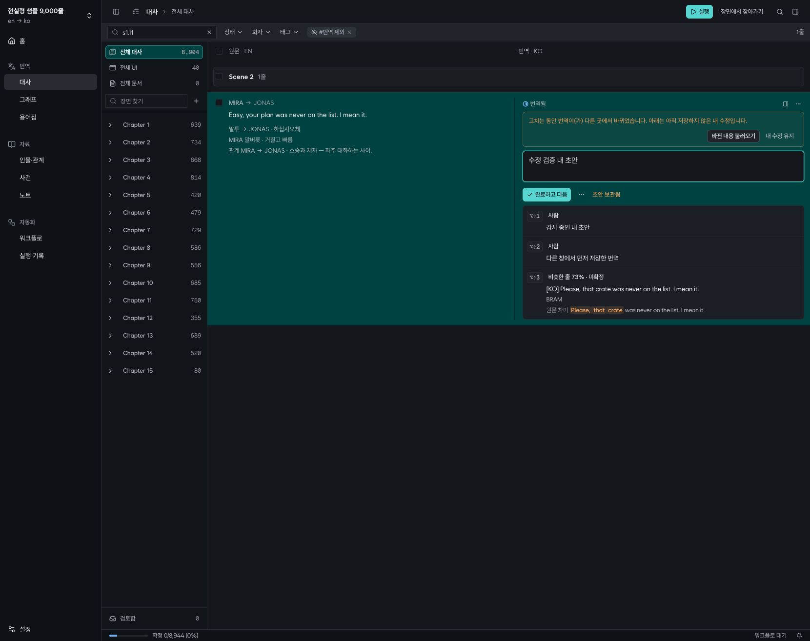
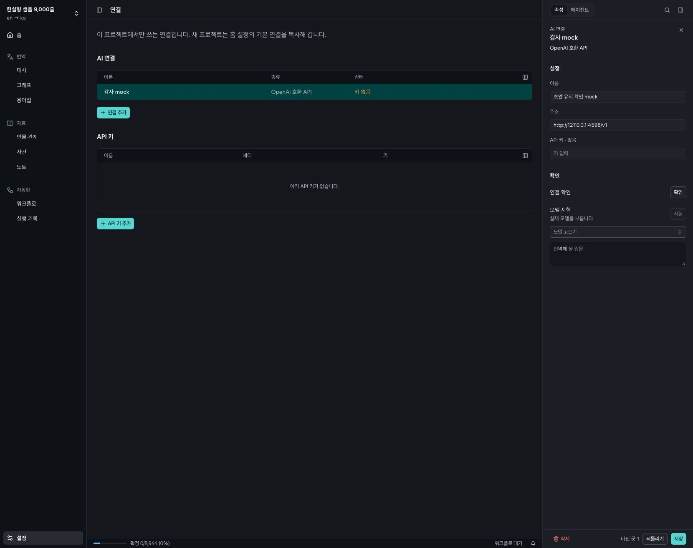
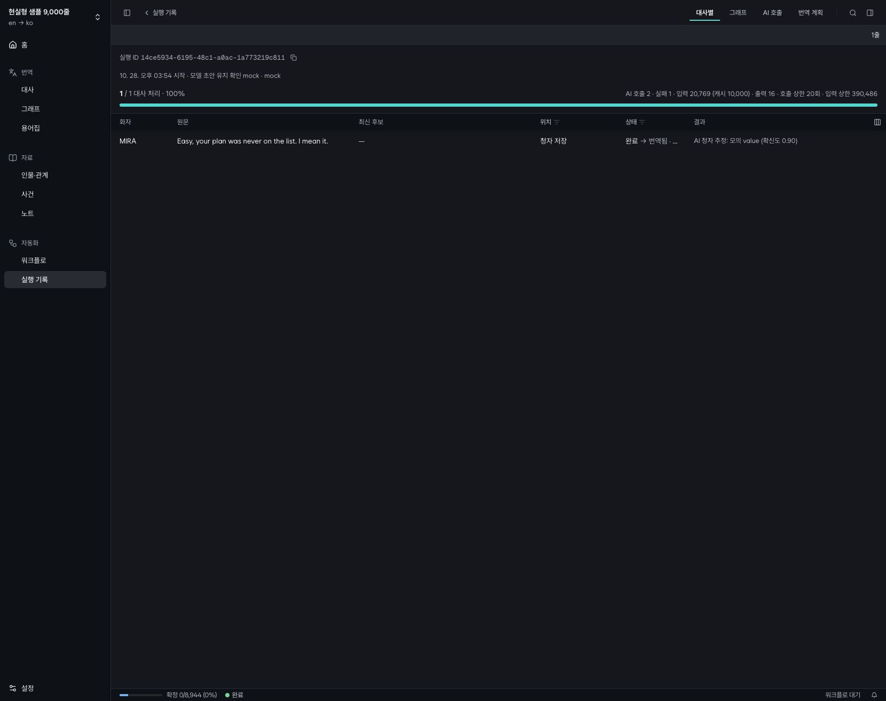

# 전수 감사 후 수정 결과 · 2026-10-28

[전수 감사](REFACTOR-AUDIT-2026-10-27.md)의 R01–R15를 수정했다. 기존 서비스·공용 UI 구조를 유지하고, 데이터 손실·실패 복구·불필요한 중복을 중심으로 변경했다. 이 문서의 검증은 2026-10-28 수정 작업을 기준으로 하며, 배포는 수행하지 않았다.

## 항목별 결과

| ID | 반영한 변경 | 확인한 근거 |
|---|---|---|
| R01 | 번역 초안과 편집 시작 시점의 기준 번역을 sessionStorage에 함께 보관. SSE로 기준값을 바꾸지 않으며 충돌 시 저장을 막고 ‘바뀐 내용 불러오기 / 내 수정 유지’를 표시 | 초안 기준·계속 입력·기존 초안 테스트 3개. 실제 브라우저에서 다른 저장 수신 → 저장 차단 → reload 후 초안·충돌 유지 → 명시적 선택 후 저장 |
| R02 | 연결 복사에서 원본에 키가 없으면 대상 키 제거. `connection_key_copies`에 미완료 ID 쌍을 기록하고 키 적용 완료 전에는 이전 키를 사용하지 않음 | pull/push 키 교체·제거, 키 삭제 실패 주입, 실패 중 연결 해석 거부, 재시도 후 정상 사용 |
| R03 | 키 복사 후에만 연결 이전 완료 표시. 시작 시 미완료 복사를 재시도하며 같은 연결 ID를 재사용 | 두 프로젝트 중 두 번째 키 저장 실패 → 미완료 유지 → 재실행으로 키 복구, 연결 중복 없음 |
| R04 | 삭제 취소에 자료 태그·태그 메모·대사 태그 연결 포함. 삭제 묶음을 트랜잭션으로 처리하고 복원 성공 후에만 토큰 제거 | 인물·관계 cascade 및 태그 자체 삭제/복원 테스트. 원래 재현에서 태그 1 → 복원 후 1 |
| R05 | 보기 수정·이름 변경·삭제·원본 변경·프로젝트 삭제 시 관련 레이아웃 worker 취소. 늦은 완료가 캐시를 쓰거나 새 작업을 제거하지 못하게 차단 | 제어된 worker 경쟁 테스트 3개 + 실제 worker 재현에서 보기 1노드/저장 레이아웃 1노드·새 이름 일치 |
| R06 | 낙관적 저장 실패 시 과거 목록 전체를 덮어쓰는 대신 관련 쿼리를 무효화하고 서버 상태 재조회 | A 저장 실패와 B 저장 성공이 겹쳐도 B 유지. 실제 QueryClient/QueryObserver 회귀 테스트 |
| R07 | 원문·화자·키·순서·소속 변경 및 줄 추가·삭제 시 용어 등장/예문 캐시 무효화. `units → terms` SSE 의존성 추가 | DB trigger 테스트: 원문·화자·키·추가·삭제 재집계, 번역만 수정할 때 캐시 유지. 원래 재현에서 캐시 0/실제 0 일치 |
| R08 | 그래프 참조 해석에서 전체 대사를 한 번 읽고 ID·키 인덱스로 조회 | 9천 줄, keep 2,000개: 조회 2,003회 → 4회, 약 4.3초 → 16ms. 참조 수와 무관하게 대사 스캔 1회라는 테스트 |
| R09 | 저장 동작 없이 성공 알림만 표시하던 용어집 ‘번역 고정’ 메뉴 제거 | 브라우저 컨텍스트 메뉴 확인. 별도 잠금 기능을 추가하지 않음 |
| R10 | 연결 설정 일반 필드를 기존 `useFormFrom` 영속 초안으로 전환. 변경 필드만 저장하고 다른 저장과 충돌하면 선택 제공 | 브라우저 이동 → Back → Forward → Back → reload 후 이름 초안 유지 → 실제 저장 성공. API 키는 sessionStorage에 넣지 않음 |
| R11 | 채팅 삭제 전 턴 중지·종료 대기, 대기 중 새 턴 차단, ACP 세션 종료와 MCP host dispose. 프로젝트 삭제에서도 적용 | 대기 턴 거부 테스트, 삭제 후 MCP 토큰 401 테스트, 실행 중 실제 API 대화 삭제 후 record 404·stream 204 |
| R12 | CLI 테스트마다 독립 임시 디렉터리를 주입해 자신이 만든 폴더만 누수 검사 | 단독 및 전체 병렬 테스트에서 CLI 테스트 통과 |
| R13 | 직접 사용하지 않는 의존성 선언 16개와 lockfile의 불필요한 항목 제거 | offline frozen install, 전 패키지 타입 검사, 앱 build, Storybook build 통과 |
| R14 | 8개 태그 생성·부착 흐름을 공용 함수로 통합. 공유 팔레트의 `hex`를 사용하고 생성/부착 실패를 구별 | 공용 함수 테스트 2개. 브라우저 용어 태그 생성·부착 후 reload에도 유지 |
| R15 | 중복 접두사가 붙은 형식 규칙 추정 라우트 제거, 호출 측 `any` 우회 제거 | 타입 검사 및 전체 라우트 테스트 통과 |

## 전체 검사

- `pnpm install --offline --frozen-lockfile`: 통과.
- `pnpm verify`: **167개 파일, 1,111개 테스트 통과**, 타입 검사 및 UI rules 통과, budget 통과.
- budget: 7개 시나리오 모두 completed, unfinished 0. 실패를 주입한 번역 시나리오의 최종 실패 줄 0. 인물 시나리오에는 의도된 오류 주입 결과로 실패 줄 1개가 남았으며 예산 기준은 통과했다.
- `pnpm build`, `pnpm build-storybook`: 통과. 기존 대형 번들 경고는 남는다.
- `git diff --check`: 통과.
- 첫 전체 실행에서 새 레이아웃 취소 함수를 제공하지 않던 기존 mock 때문에 7개 테스트가 실패했다. 해당 mock을 보완한 뒤 전체 검사를 다시 통과했다.

[전체 검사 로그](audits/2026-10-28-fixes/verify.log) · [앱 빌드](audits/2026-10-28-fixes/build.log) · [Storybook 빌드](audits/2026-10-28-fixes/storybook.log) · [서비스 재현 결과](audits/2026-10-28-fixes/reproduce.json) · [경쟁 조건 결과](audits/2026-10-28-fixes/races.jsonl) · [실행 중 대화 삭제 결과](audits/2026-10-28-fixes/chat-delete.jsonl)

## 브라우저와 실동작

검증 데이터는 기존 감사용 격리 디렉터리 `/tmp/tw-refactor-audit-20261027`에 있는 현실형 샘플을 재사용했다. 실제 사용자 데이터 디렉터리와 실제 모델은 사용하지 않았다. 샘플은 9,040줄·그래프 노드 9,073개다. API 4517, Vite 4518, mock LLM 4598 및 `MOCK_PROFILE=cli-like,faulty`, 메모리 키 저장소를 사용했다. 신규 마이그레이션 0094·0095가 기존 격리 DB에 적용되는 것도 확인했다. 검증 후 세 서버를 종료하고 포트가 닫힌 것을 확인했다.

- 번역 검색·선택 URL과 초안, 충돌 상태가 reload에도 보존된다. 충돌 상태의 저장 시도 뒤 서버에는 다른 창의 번역이 그대로 남았다. ‘내 수정 유지’를 선택한 뒤 저장하면 내 번역으로 바뀐다.
- 연결 이름 초안은 페이지 이동·Back/Forward·reload 후에도 남고 저장하면 목록과 상세에 반영된다.
- 용어집의 허위 잠금 메뉴가 없고, 새 태그가 생성·부착되어 reload 후에도 보인다.
- 장면 그래프는 371노드·1,698연결, 실제 캔버스는 1452×1242. 저장된 1노드 대사 보기와 장면 보기 사이 Back/Forward가 해당 URL과 그래프를 복원한다.
- 브라우저에서 선택한 1줄 청자 추정 실행은 429 한 번 후 재시도하여 1/1 완료. 호출 2회, 실패 시도 1회, 입력 20,769(캐시 10,000), 출력 16. 실행 ID `14ce5934-6195-48c1-a0ac-1a773219c811`.
- 브라우저에서 생성한 모의 대화 삭제 후 기존 대화로 돌아오는 것을 확인했다. 별도 실제 API 재현에서는 삭제 직전 턴이 실행 중임을 검증한 다음 삭제하여 대화 404·스트림 204를 확인했다. 해당 AI 호출 기록도 `failed / 중단함`으로 끝났다. ACP MCP 토큰 해제는 fake ACP 테스트에서 별도로 검증했다.

성능 수치는 같은 현실형 샘플의 단회 로컬 재현 측정이다. 절대시간보다 참조 수에 따라 늘던 전체 대사 스캔을 제거한 것이 핵심이다.

## 적용 및 확인 범위

0094는 용어 사용 캐시 무효화 trigger, 0095는 연결 키 복사 대기 테이블을 추가한다. 대기 테이블에는 연결 ID만 보관하며 키 값은 저장하지 않는다. 키 저장소 오류가 지속되면 해당 연결 사용은 실패하고, 기본값 복사를 재시도하거나 연결 설정에서 키를 다시 저장해 복구할 수 있다.

실제 AI 제공자, macOS Keychain/Windows Credential Manager, Windows 실행은 이번 검증 범위에 포함하지 않았다. 실패 복구는 메모리 키 저장소에 오류를 주입해 확인했다. 일반 데스크톱 브라우저에서 변경 경로를 확인했으며 전체 모바일·접근성 전수 검사를 새로 수행한 것은 아니다.
