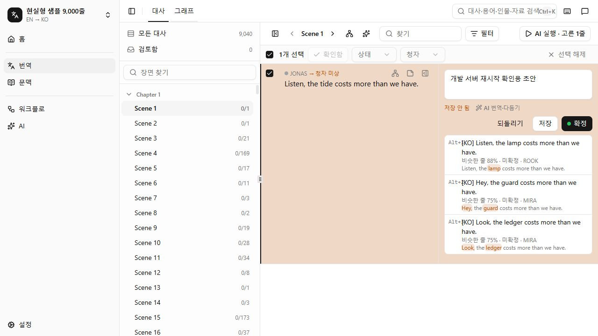
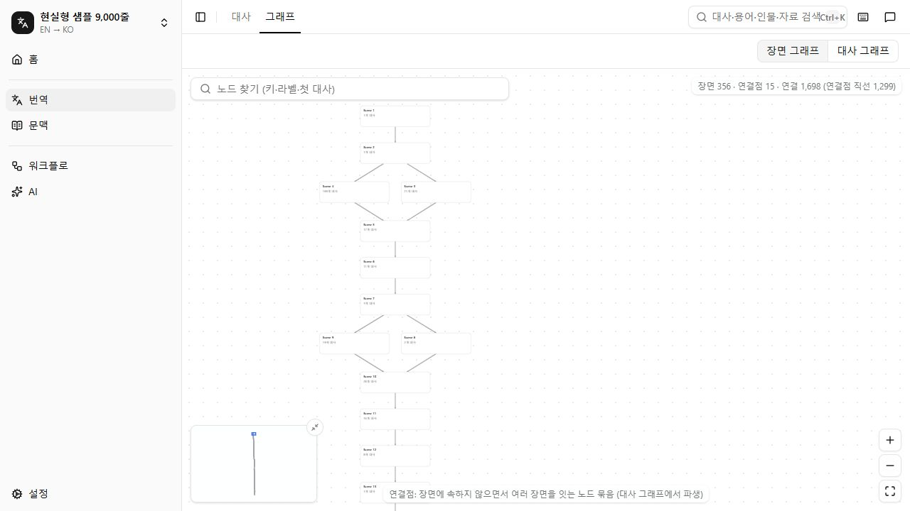
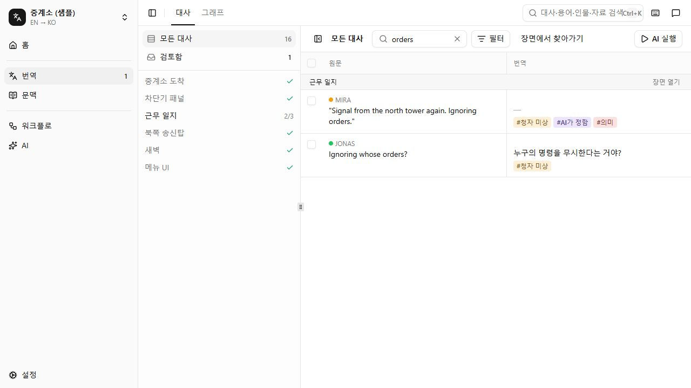
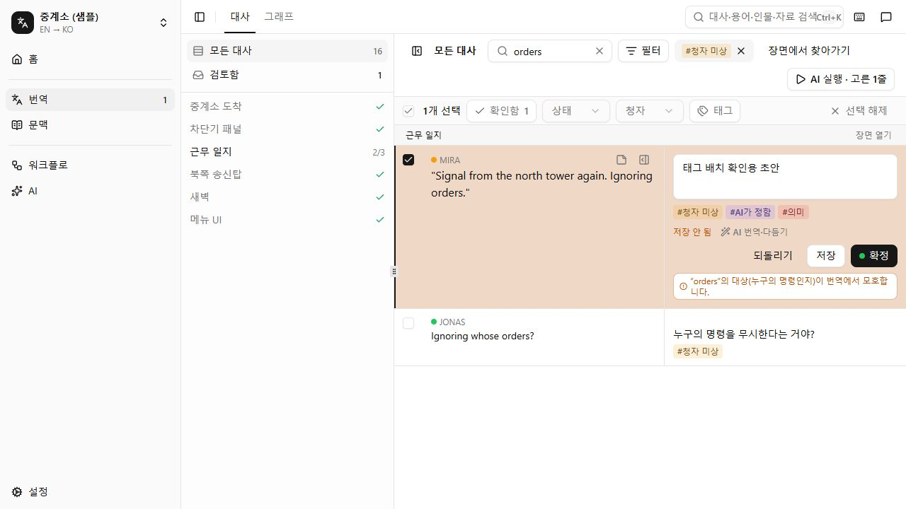
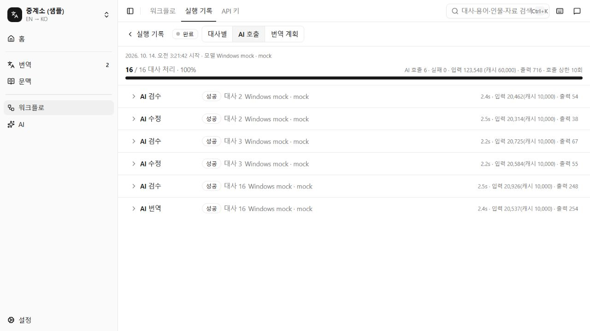
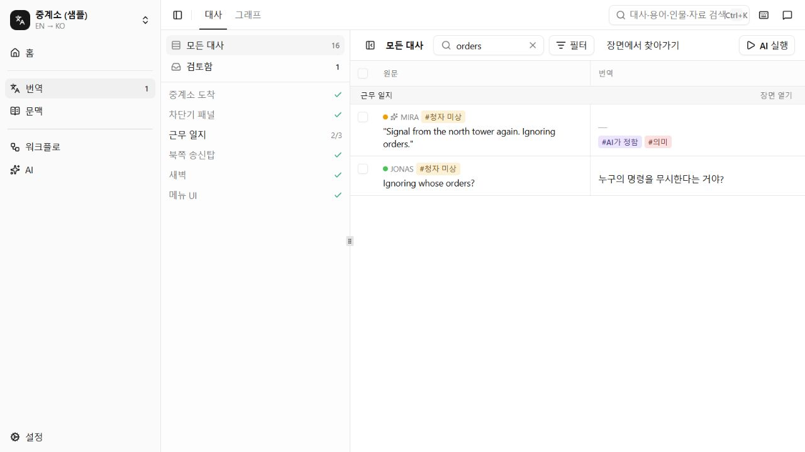

# Windows 실행 검증

2026-10-14 검증 기록. 초기 브라우저 검증은 API·Vite·mock을 각각 실행한 상태에서 진행했으며, 기본 `pnpm dev` 시작 경로를 빠뜨렸다. 사용자 실행에서 API가 준비되지 않는 문제가 확인되어 개발 실행 명령과 시작 순서를 추가로 수정·검증했다. 실제 AI 연결 대신 mock을 사용했고, 사용자 데이터는 별도의 테스트 DB와 분리했다.

## 환경과 결과

- OS: Windows NT 10.0.26300.0, x64
- Node.js 26.8.2, pnpm 10.18.0
- 브라우저: Codex 내장 브라우저, 1280 × 720
- 테스트 DB: `.windows-test/data/workbench.sqlite`
- 설치: 기존 캐시에서 `pnpm install --frozen-lockfile --offline` 성공. 새 PC에서의 다운로드 설치를 검증한 것은 아니다.

| 검사 | 결과와 근거 |
|---|---|
| `pnpm build` | 성공. 최종 Vite 빌드 6.20초. 500 kB 초과 청크 경고는 남아 있음 |
| `pnpm verify` | 종료 코드 0. TypeScript, UI 규칙, 53개 파일의 320개 테스트, 비용 회귀 검사 모두 통과. 테스트 174.87초, 비용 검사 84.8초 |
| SQLite | 네이티브 모듈, 가져오기, 마이그레이션, 백업, 저장 및 재시작 후 읽기 통과 |
| Windows 자격 증명 관리자 | 고유한 임시 항목의 한글 값 저장·읽기·삭제 성공. 기존 항목은 건드리지 않음 |
| `loca` CLI | 프로젝트 목록·한글 이름 출력과 현실형 샘플 형식 검사 성공 |
| AI CLI 어댑터 | Claude/Codex/Grok/Antigravity/opencode fake CLI 검사 통과. 실행·응답·오류·취소·시간 초과 포함 |

## 발견한 문제와 변경

1. DB 초기화가 실패하면 `openDatabase`가 SQLite 연결을 닫지 않아 Windows에서 파일 잠금이 남았다. 초기화·백업·마이그레이션·외래 키 검사 실패 시 연결을 닫고 원래 오류를 다시 던지도록 수정했다. 기존 마이그레이션 테스트 2곳에서도 성공 후 DB 연결을 명시적으로 닫는다. 관련 테스트의 `EPERM` 정리 실패가 해소됐다.
2. 기본 병렬 검사에서 용어 성능 검사가 5초 기준을 넘었다(5.64초). worker 4개로 제한한 초기 전체 검사는 통과했지만, PR 직전 전체 재검사에서는 6.58초로 다시 실패했다. 같은 검사를 worker 1개로 단독 실행하면 기존 5초 기준으로 통과했다. Windows에서는 테스트 파일을 worker 1개로 순차 실행해 대량 SQLite 검사와 성능 검사의 CPU 경쟁을 줄이고, 다른 OS는 worker 4개를 유지한다. 용어 성능 검사의 5초 기준은 변경하지 않았다. 최종 전체 검사는 53개 파일의 320개 테스트가 174.87초에 모두 통과했다.
3. 34,000줄 실행 완료 검사가 60초 제한을 넘었다. 이 검사는 SQLite bind 한도 초과 시 모든 줄이 끝나는지 확인하는 기능 검사이므로 제한을 120초로 조정했다. 완료 상태·34,000개 항목·모든 항목의 `done` 검증은 유지했다. 최종 `runner-guards.test.ts` 파일 전체는 90.9초로 통과했다. 실행기 성능을 개선한 변경은 아니다.
4. README에 PowerShell 5.1의 실행 명령과 Windows 단축키를 추가하고, 현재 모델 선택 UI에 맞춰 프로필 설명을 고쳤다.

## 기본 `pnpm dev` 추가 검증

- 재현: Windows Node 26.8.2에서 `pnpm --parallel --filter @tw/server dev`의 `tsx watch src/main.ts` 하위 프로세스가 살아 있어도 API 포트가 열리지 않았다. 서버를 개별 실행하면 준비됐다. tsx 내부에서 멈추는 구체적인 원인까지 규명한 것은 아니다.
- 수정: 서버의 `dev`를 `node --watch --import tsx src/main.ts`로 바꿨다. TypeScript 로더는 유지하고 파일 감시를 Node 기본 기능에 맡긴다. [Node 공식 문서](https://nodejs.org/api/cli.html#--watch)의 지원 범위 안이며 Windows 전용 쉘 명령이나 경로는 추가하지 않았다. macOS에서 변경 후 실행은 검증하지 못했다.
- 첫 실행 경쟁: API 초기화보다 Vite 준비가 빨라, 기존 브라우저의 요청이 502 오류를 받고 라우터 오류 화면에 머물 수 있었다. 개발 모드에서만 Vite 설정이 `p-retry`로 API의 `/api/projects` 응답을 최대 30초 기다리게 했다. 앱 실행 중 데이터를 갱신하는 폴링은 추가하지 않았다.
- Windows에서 루트의 **`pnpm dev` 자체**로 기본 포트 4317·4318을 실행했다. 기존 격리 DB, 빈 격리 DB, 기본 Windows 키 저장 설정을 사용했다. API 시작 로그 다음에 Vite 개발 주소가 표시됐다. API·Vite 프록시의 `/api/projects`와 `/api/events`가 200 응답하고 SSE의 Content-Type은 `text/event-stream`이었다.
- 브라우저에서 기본 주소의 프로젝트 목록·9,040줄 프로젝트·장면 대사를 확인했다. API 파일의 내용은 바꾸지 않고 수정 시간을 변경했을 때 자동 재시작하고 프록시가 다시 200으로 응답했다. 재시작 순간 기존 SSE 연결에 `ECONNRESET` 로그가 한 번 나타났으며 이후 연결이 복구됐다.
- Ctrl+C 후 4317·4318 포트가 모두 닫혔고 같은 기본 명령으로 재실행했다.
- API 없이 웹 `dev`만 실행하면 30초 후 API 주소와 서버 로그 확인 안내를 출력하고 종료 코드 1로 끝났다. API 없이 실행한 최종 `pnpm build`는 종료 코드 0, Vite 빌드 2.59초로 통과했다. 500 kB 청크 경고는 기존과 같다.
- 추가 회귀: Node 파일 감시 모드는 그래프 워커의 `message`에도 `watch:import`·`watch:require` 알림을 보낸다. 기존 `once('message')`가 이를 계산 실패로 오인하고 워커를 종료해 빈 오류가 저장됐다. Zod로 계산 응답의 형식을 확인하고 내부 메시지는 건너뛴다. 성공 결과와 실제 실패 이유가 내부 메시지 뒤에 오는 회귀 테스트 2개와 관련 그래프 검사 9개, 전체 패키지 타입 검사가 통과했다. 별도의 셸·OS 분기는 없다.
- 최종 격리 DB `.windows-test/dev-startup-verified`에서 9,040줄 샘플의 장면 그래프(표시 노드 371개), Chapter 1 대사 그래프(67개), 전체 대사 그래프(473개)가 표시됐다. 15개 구역이 계산됐으며, native Back에서 Scene 1의 선택·한글 초안이 복원되고 Forward로 그래프에 복귀했다. 종료 후 같은 `pnpm dev`로 재실행해 브라우저 새로고침과 API·프록시·SSE를 다시 확인했다. 재실행 한 번은 감시 모드의 시작 중 재시작 로그가 여러 번 발생해 Vite 준비까지 22.8초 걸렸다. 해당 로그의 원인은 규명하지 못했으며 이후 API가 준비되고 화면이 로딩됐다.





## 실제 브라우저에서 확인한 여정

### 대사 태그 통합 추가 검증 (2026-10-14)

대사 목록의 자동 표시·문제 유형·사용자 태그를 번역 아래 한 줄로 모았다. 화자 옆의 청자 미상 칩·AI ✦·메모 아이콘은 제거했다. 편집기에서는 입력 칸 바로 아래 같은 태그 줄을 사용하며 AI 설명이 중복되지 않는다. 태그 클릭은 URL 필터를 적용하고 행·체크 선택을 바꾸지 않는다.

- 기본 `pnpm dev`와 mock LLM(4598), 격리 DB `.windows-test/data` 사용. 실제 AI 요청이나 사용자 번역 저장은 하지 않았다.
- 16줄 샘플의 `orders` 검색: 빈 번역에는 청자 미상·AI 지정·의미 칩, 저장된 한글 번역에는 청자 미상 칩이 모두 오른쪽에 표시됐다. 문제 태그와 자동 표시 필터가 URL에 남고, 편집 중 필터를 눌러도 초안·체크 선택이 유지됐다.
- 그래프 이동 → native Back에서 검색·표시 필터·선택·초안 복원 → Forward로 그래프 복귀. 새로고침 후에도 복원됐다.
- 9,040줄 목록: 청자 미상 필터 5,845줄, 101–200 페이지 이동과 새로고침 후 같은 필터·페이지 및 오른쪽 태그 배치 확인.
- 웹 타입 검사·UI 규칙·`pnpm build` 통과. 최종 Vite 빌드 6.20초, 기존 청크 크기 경고는 유지.
- 검증 중 초기 Node 기본 모듈 감시가 `node_modules` 알림에 재시작을 반복했고, 그 순간 새로고침은 502 오류가 났다. 최종 실행은 `node dev.mjs`에서 Windows·macOS에 `--watch-path=src`·`--watch-path=../../packages`를 사용하고 Linux에는 기본 `--watch`를 유지한다. 기본 명령 시작은 7.56초였으며 빌드 중 반복 재시작은 사라졌다. 소스 파일 수정 시간 변경에서는 한 번 재시작하고 API·프록시가 200으로 복구됐다. macOS·Linux 직접 실행은 아직 검증하지 못했다.





| 여정 | 확인 결과 |
|---|---|
| 현실형 샘플 가져오기 | 파일 선택 → 서버 형식 검사 → 9,040줄·9,073노드·10,400간선 요약 → 프로젝트 생성 성공 |
| 대본 탐색·초안 | Scene 1의 첫 대사 선택 → 한글 초안 입력 → 체크박스 선택 → 그래프 이동 → native Back. 초안과 선택이 복원됐고 Forward로 그래프에 복귀 |
| 대규모 그래프 | 장면 그래프와 대사 그래프, Chapter 1과 전체 범위 표시 성공. 전체 9,073개 원본 노드 중 체인 8,866개가 266개 덩어리로 접힘. 확대와 드래그 이동 확인. 프레임 속도 수치는 측정하지 않음 |
| 검색 상태 | `orders` 검색 → 문맥 화면 이동 → native Back에서 검색어와 결과 복원 |
| mock AI 연결 | 로컬 OpenAI 호환 연결 추가 → 모델 목록 불러오기 → `mock` 모델 확인 성공 |
| 번역 실행 | 작은 샘플 전체 16줄 선택 → 예상 요청 수 확인 → 실행 → SSE로 진행 갱신 → 완료. AI 호출 6회, 호출 실패 0회. 번역·검수·수정과 형식 검사 기록 표시 |
| 검토·저장 | 검토함 2줄 중 `Ignoring whose orders?`를 한글로 입력 → Ctrl+Enter → 저장·확정. 검토함이 1줄로 줄고 AI 지정 표시가 사라짐 |
| Windows 단축키 | Ctrl+K 검색창과 Ctrl+I 전역 채팅 패널 열기 성공 |
| 프로덕션 실행 | API 재시작 후 Vite 없이 4517 포트의 대본 URL 직접 접속·새로고침 성공. `orders` 필터, 저장된 한글 번역과 검토함 1줄 유지. 해당 탭의 console error/warn 없음 |

한글 문자열 입력·저장·표시는 확인했다. Windows IME의 실제 조합 입력, 외부 브라우저별 동작, 최소 지원 Node 22.12, 실제 로그인된 AI CLI와 원격 모델은 별도 확인 대상이다.

개발 모드에서 검색어 입력 직후 화면을 전환하는 과정에 `Could not find match for from: /p/$projectId/script` 경고가 한 번 기록됐다. 검색 상태를 URL에서 확인한 뒤 수행한 Back 복원은 통과했다. 빠른 입력·화면 전환의 라우터 경고는 남은 확인 항목이며, Windows 전용 문제로 판정하지 않았다.





## 9천 줄 비용 회귀

`pnpm verify`에 포함된 최종 `pnpm budget` 결과다. 각 시나리오는 9,040줄이며, 모델 응답과 토큰 사용량은 mock으로 생성한다. 아래 시간에는 실제 모델 대기 시간이 포함되지 않는다.

| 시나리오 | 완료 | 호출 | 실패 호출 | 실패 줄 | 검사 시간 |
|---|---|---:|---:|---:|---:|
| 번역 `cli-like` | 완료 | 434 | 0 | 0 | 21.8초 |
| 번역 `cli-like,faulty` | 완료 | 515 | 36 | 11 (0.1%) | 25.8초 |
| 청자 추정 | 완료 | 106 | 0 | 0 | 5.4초 |
| 용어 추출 | 완료 | 176 | 0 | 0 | 19.3초 |
| 자료 갱신 | 완료 | 91 | 0 | 0 | 6.0초 |

합계 84.8초, `budget ok`. 오류 프로필의 실패 줄은 남은 실패를 기록하는 정상 경로이며 기준선 허용 범위 안이다. 비용 기준선은 변경하지 않았다.

## PowerShell에서 재현

저장소 루트에서 실행한다. 포트 4517·4518·4598을 사용하므로 기존 기본 포트의 앱과 구분할 수 있다.

```powershell
pnpm install --frozen-lockfile
pnpm verify
pnpm build
pnpm samples -- --profile realistic --size 9000
```

API 터미널:

```powershell
$env:WORKBENCH_DATA_DIR = Join-Path (Get-Location) '.windows-test/data'
$env:WORKBENCH_SECRETS = 'memory'
$env:WORKBENCH_PORT = '4517'
pnpm --filter @tw/server start
```

Vite 터미널:

```powershell
$env:WORKBENCH_PORT = '4517'
pnpm --filter @tw/web dev --port 4518 --strictPort
```

mock 터미널:

```powershell
$env:MOCK_LLM_PORT = '4598'
$env:MOCK_PROFILE = 'cli-like'
pnpm mock-llm
```

`http://127.0.0.1:4518`에서 샘플을 가져오고, AI 연결 주소를 `http://127.0.0.1:4598/v1`, 모델을 `mock`으로 설정한다. 이미 가져온 프로젝트의 AI 노드에는 이 연결·모델을 지정해 저장한다. 작은 샘플은 `samples/relay-station.json`, 대량 샘플은 `samples/realistic-9k.json`이다.

프로덕션 확인은 같은 API 터미널에서 `pnpm start`로 실행한 뒤 `http://127.0.0.1:4517`을 연다. 테스트 후 각 터미널에서 Ctrl+C로 종료한다. `.windows-test/data`는 테스트 전용이며 실제 데이터 경로 `.workbench`와 구분한다.
